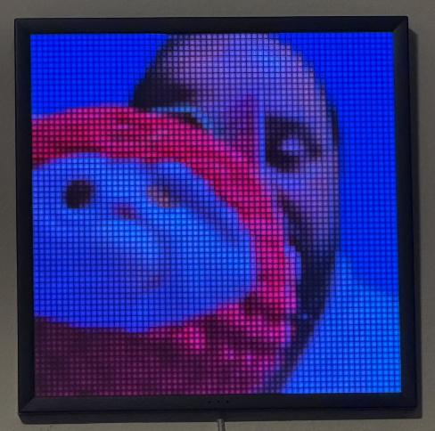

<p align="center">
  
</p>

# divroom

An open-source toolkit for **exploring and driving the Divoom Pixoo 64** on
your own network. It discovers the device, controls the 64×64 display through
the device's local HTTP API, streams creative content to it, and — for the
curious — passively documents what the device says on the wire.

Built for **stock firmware** (no flashing). Everything talks to the device's
own local API; nothing here depends on the Divoom cloud except optional
discovery.

> ⚠️ **Scope & authorization.** This project is for devices and networks you
> own or are explicitly authorized to test. The discovery and control tools
> are LAN-scoped by design. Do **not** point them at devices or networks you
> don't control. See [SECURITY.md](SECURITY.md).

---

## Features

- **Discover** — find the Pixoo on your LAN (Divoom's `ReturnSameLANDevice`
  cloud lookup, with an ARP + local-API probe fallback).
- **Control** — color, scrolling text, brightness, channel, screen on/off,
  image/GIF upload, and a raw-command passthrough.
- **Animations** — procedural `rainbow`, `plasma`, `sweep`, `pulse`, and
  linear `gradient` fills generated locally.
- **16colo.rs slideshow** — auto-pick a random ANSI/ASCII art piece by year,
  pan a 64×64 window down it, hold ~30s, advance. Prefetches ahead so there's
  no gap between pieces.
- **Webcam streaming** — stream a Mac camera live to the panel via ffmpeg
  (one HTTP request per frame for near-real-time rates).
- **Localhost dashboard** — a small web UI for all of the above, bound to
  `127.0.0.1` only.
- **Passive observation** — analyze what the device sends on the wire
  (DNS/SNI/endpoints, cleartext geolocation), observation-only, no MITM.
  See [FINDINGS.md](FINDINGS.md).

## Install

```bash
python3 -m venv .venv
.venv/bin/pip install -r requirements.txt
```

Optional, for the passive-capture tooling only:

```bash
.venv/bin/pip install -r requirements-capture.txt   # scapy
```

## Dashboard

```bash
./launch                 # opens http://127.0.0.1:8000
PORT=8080 ./launch       # custom port
```

The server binds to `127.0.0.1` only and rejects mutating requests from
non-localhost Origins.

## CLI

`pixoo.py` is a thin CLI over the same modules. Pass `--ip` (or set
`PIXOO_IP`) to skip discovery:

```bash
.venv/bin/python pixoo.py --ip 192.168.4.20 color ff0080
.venv/bin/python pixoo.py --ip 192.168.4.20 text "BRB" --background 000000 --color "#00FF00"
.venv/bin/python pixoo.py --ip 192.168.4.20 image ~/Pictures/cat.gif
.venv/bin/python pixoo.py --ip 192.168.4.20 animate plasma --speed 80
.venv/bin/python pixoo.py --ip 192.168.4.20 gradient ff0080 00e0ff --angle 45
.venv/bin/python pixoo.py --ip 192.168.4.20 slideshow --year 1994 --hold 30
.venv/bin/python pixoo.py --ip 192.168.4.20 camera --index 0
.venv/bin/python pixoo.py --ip 192.168.4.20 info
```

### Passive observation

```bash
# Analyze a capture you took at a gateway/router you control:
.venv/bin/python pixoo.py sniff analyze capture.pcap --device-ip 192.168.4.20

# Best-effort live listen (needs scapy + capture privileges; on a switched
# LAN this mostly sees broadcast/multicast + this host's own traffic):
sudo .venv/bin/python pixoo.py sniff live --iface en0 --seconds 60 --device-ip 192.168.4.20
```

This is **observation only** — it reads what the network already hands you.
It never spoofs ARP, injects packets, or decrypts TLS. See
[SECURITY.md](SECURITY.md) and [FINDINGS.md](FINDINGS.md).

`carve_firmware.py` is a companion tool that carves HTTP response bodies out
of a pcap you captured (reassembling TCP streams) and flags likely firmware
images — useful for studying OTA update traffic. It also needs scapy.

```bash
.venv/bin/python carve_firmware.py capture.pcap --out carved
```

## Live webcam → panel

<p align="center">
  
</p>

Stream a camera straight to the 64×64 matrix in near real time:

```bash
.venv/bin/python pixoo.py --ip 192.168.4.20 camera --index 0
```

How it works (`divroom/camera.py`):

- **ffmpeg** grabs the camera via `avfoundation`, center-crops to a square,
  and scales to 64×64 `rgb24`, piping raw frames out. It probes each camera's
  supported modes and picks one (avoiding avfoundation's unsupported 29.97
  default), so heterogeneous cameras just work.
- A **reader thread** keeps only the *latest* frame and a **pusher thread**
  sends it as fast as the device accepts, so capture and push rates are
  decoupled — you always see the freshest frame with no lag build-up.
- Each frame is **one HTTP request** (`Draw/SendHttpGif` with its own
  `PicID`, resetting the GIF id every 60 frames) instead of the usual
  reset + get-id + send round-trips — roughly 3× the frame rate, close to live.
- `pixoo.py camera` lists available cameras; pick one with `--index`. On
  macOS the launching process needs Camera access
  (System Settings ▸ Privacy & Security ▸ Camera).

The same stream is available from the dashboard's **Camera** panel
(pick a device, Start/Stop, live fps readout).

## The device's local API

The Pixoo 64 exposes an **unauthenticated** JSON HTTP API on port 80:

```bash
curl -s http://<device-ip>/post -d '{"Command":"Channel/GetAllConf"}'
```

`divroom/control.py` wraps the subset this project uses (`Draw/SendHttpGif`,
`Channel/*`, `Draw/SendHttpText`, …). That there is no authentication is a
property of the device, documented in [SECURITY.md](SECURITY.md).

## Tests

```bash
.venv/bin/python -m pytest -q
```

The live-device test is skipped unless `PIXOO_LIVE=1 PIXOO_IP=<ip>` are set.
The passive-observation analyzers are fully unit-tested without scapy or a
network.

## Project layout

```
divroom/
  control.py     # local HTTP API client (the device driver)
  discovery.py   # find the device on the LAN
  animate.py     # procedural frame generators
  art.py         # 16colo.rs piece fetch + pan
  slideshow.py   # prefetching slideshow worker
  camera.py      # ffmpeg webcam → panel
  sniff.py       # passive traffic analysis (observation only)
  server.py      # localhost FastAPI dashboard
  static/        # dashboard UI
pixoo.py             # CLI (control + sniff)
carve_firmware.py    # carve firmware/HTTP bodies from a pcap
tests/               # pytest suite
```

## License

[MIT](LICENSE).

## Contributing

See [CONTRIBUTING.md](CONTRIBUTING.md). This is hobby/research software;
issues and PRs welcome, but keep the authorization boundary in mind.
